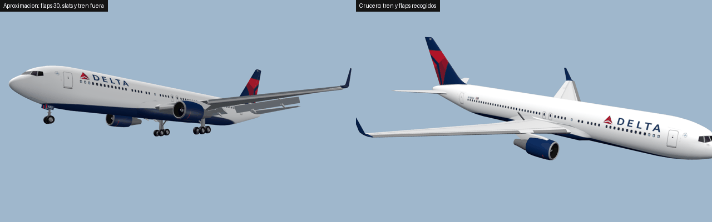
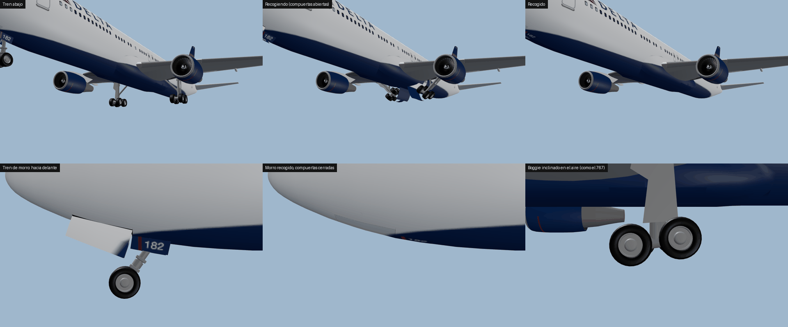
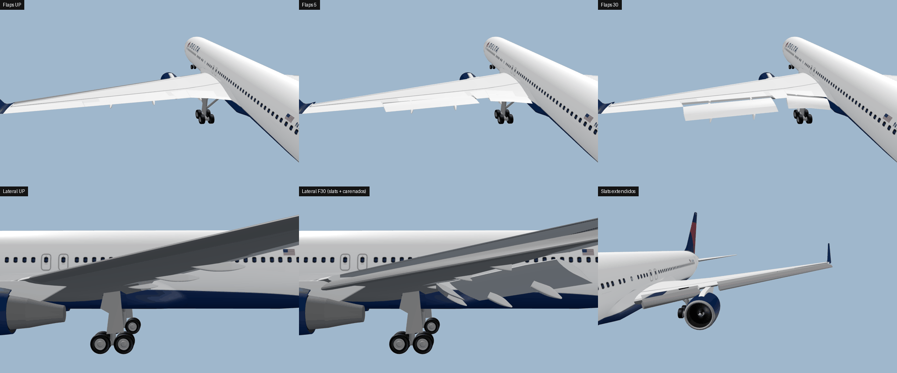
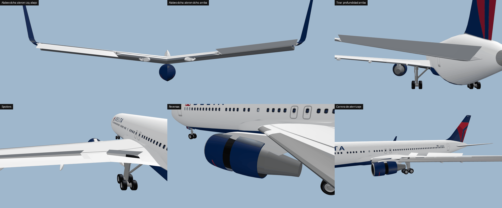
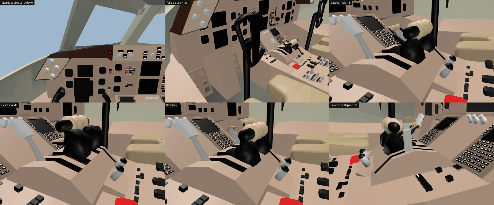
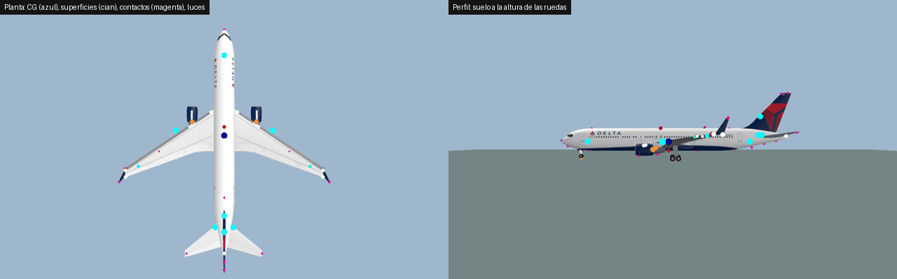

# Boeing 767-300ER (winglets) para GeoFS



Avión completo para GeoFS hecho sobre el modelo **763W3_1** (767-300ER con winglets, librea Delta)
y la cabina **767-200ER cockpit**. El modelo y el código original son de **GT**; su aviso de copyright
se conserva tal cual en `aircraft.json`. El código se ha rehecho casi entero porque el original estaba
escrito para otro modelo (un 767 más largo, el "7621.glb") y con este no funcionaba.

## Contenido

```
aircraft/
├── 767-300ER/                 ← la carpeta que se sube a GeoFS
│   ├── aircraft.json          definición del avión (física, animaciones, luces, cámaras, sonido)
│   ├── 767-300ER.glb          modelo exterior (= 763W3_1.glb, sin cambios)
│   ├── shadow.glb             sombra simple (nueva; GeoFS la pide con sombras "simples")
│   └── cockpit/
│       ├── cockpit.json       cabina (se carga al entrar en la vista de cabina)
│       └── cockpit.glb        = 767-200_ER cockpit.glb, con las palancas de reversa colgadas de las de gases
├── 767-300ER-loader.js        script para cargarlo en GeoFS desde este repositorio
├── docs/                      imágenes de comprobación
└── tools/                     validador, simulador de vuelo y generador
```

## Probarlo en GeoFS

1. Abre GeoFS y espera a que cargue.
2. Abre la consola del navegador (F12 → Consola), pega el contenido de `767-300ER-loader.js` y pulsa Enter.
3. El avión se carga desde GitHub (`raw.githubusercontent.com`) como avión *local*.
   Cuando esta rama se fusione en `main`, cambia `BRANCH` en el script a `'main'`.

Para enviarlo como avión de la comunidad, sube la carpeta `767-300ER/` tal cual: GeoFS espera
`aircraft.json` en la raíz y `cockpit/cockpit.json` en la subcarpeta, y los modelos al lado de cada JSON.
No se usan animaciones con `function`, que GeoFS desactiva en los aviones de la comunidad.

## Qué estaba mal en el código original

Pasado por el validador (`tools/validate_geofs.py`) contra estos modelos, el código original da
**66 errores**:

- **58 referencias a nodos que no existen** en los `.glb` (`wingLeft0`, `Aileron L`, `Slat Left 2`,
  `horizontalStabLeft`, `Main Gear Front Left`, `Throttle`, `Yoke L`, `Gear Lever`…): esas piezas no se mueven.
- **Piezas duplicadas** (`outboard_flap_right_2`, `inboard_flap_right_2`): la segunda pisa a la primera.
- **Física y animación mezcladas en la misma pieza.** GeoFS gira el nodo en *sus ejes locales del glTF*
  y la física en los ejes del avión, que casi nunca coinciden:
  - el **timón de dirección** giraba la fuerza sobre el eje longitudinal, así que en vuelo **no hacía nada**;
  - el **alerón interior derecho** tenía el mismo signo que el izquierdo, así que se anulaban;
  - las alas y los estabilizadores dependían de nodos inexistentes y sin `position` (si el nodo existe,
    GeoFS toma su posición en ejes glTF, que van en otro orden).
- **Valores de animación que no existen** (`gear_left_suspensionRotation`): las ruedas nunca giraban.
- Puntos de colisión de un avión unos 6 m más largo: el morro y la cola tocaban el suelo por fuera del
  modelo visible, y las dos ruedas de morro de la física quedaban por delante del morro.
- Física poco realista: 70 t de masa, resistencia de spoilers y tren incluso recogidos y ninguna pérdida
  de empuje con la altura: a FL350 con gases a fondo el avión seguía acelerando hasta ~Mach 1,15.

## Qué se ha hecho

**Física (separada de las piezas visuales).** Cada superficie aerodinámica es una pieza sin nodo, con
posición y ejes del avión; las piezas visuales solo mueven nodos.

| Elemento | Cómo está modelado |
|---|---|
| Masa / CG | 145 000 kg (peso medio entre despegue y aterrizaje), CG al ~25 % de la cuerda media |
| Alas | 2 semialas con incidencia 2,7°, diedro 6°, los flaps suben la incidencia y retrasan el centro de sustentación, los slats suben el ángulo de pérdida (por posición de flaps) y los spoilers quitan sustentación |
| Alerones | interiores siempre activos; exteriores solo con flaps fuera (como el 767 real) |
| Profundidad | estabilizador + elevador; la autoridad del elevador baja con la velocidad (como un *feel computer*) sin cambiar la estabilidad; compensador sobre todo el estabilizador |
| Dirección | deriva + timón que ahora sí genera fuerza lateral |
| Amortiguadores | pares delante/detrás del CG cuyos momentos estáticos se anulan: solo amortiguan cabeceo y guiñada |
| Resistencia | parásita + **inducida cuadrática** (∝ CL², vía `aoa`) + **onda** por encima de Mach 0,73 + tren + flaps + aerofrenos; nada de esto actúa si el elemento está recogido |
| Motores | 2 × 267 kN (CF6-80C2/PW4060), reversa 90 kN, el empuje baja con la altitud (`zeroThrustAltitude`) y con el Mach |
| Tren | 1 rueda de morro con dirección ±35° y 4 ejes principales (rota sobre el eje trasero), suspensión con recorrido real |
| Piloto automático | parámetros propios: límite de alabeo 22° (en los virajes llega a ~30° por la inercia de alabeo de GeoFS) y ±4000 ft/min |

**Animaciones** (todas comprobadas en un visor 3D que reproduce exactamente cómo GeoFS mueve los nodos):
flaps con desplazamiento Fowler y carenados, slats, alerones, profundidad, timón, 14 spoilers, tren
principal hacia dentro con compuertas que se abren y cierran, tren de morro hacia delante con sus
compuertas, compresión de la suspensión, boggies inclinados en el aire, dirección y giro de la rueda de
morro, fans, reversas. En cabina: yokes (alabeo y cabeceo), gases, reversas, aerofrenos, flaps por
posiciones y palanca del tren.






**Luces:** navegación roja/verde y blancas traseras en las puntas, estrobos en puntas y cola, beacons
rojos arriba y abajo, luces de aterrizaje y de taxi con el tren fuera. Se apagan con los motores parados.

**Cámaras:** cabina en la posición del comandante (mirando un poco hacia abajo para ver el PFD), ala
izquierda, ala derecha, cola y tren. **Sombra simple** nueva con la silueta del avión.



## Datos de vuelo (simulados con la física de GeoFS, 145 t)

| Prueba | Este avión | 767-300ER real (aprox.) |
|---|---|---|
| Crucero FL350 M0.80 | cabeceo 2,2°, 91 kN de empuje total, L/D 15,7 | 2–3°, L/D 16–18 |
| Velocidad de pérdida UP / F5 / F20 / F30 | 145 / 127 / 120 / 113 kt | ~145 / 126 / 119 / 111 kt |
| Vref 30 | 138 kt | ~137–140 kt |
| Aproximación F30 en senda de 3° | cabeceo 3,9°, ~25 % de gases | ~4° |
| Despegue F15 (Vr 145 kt) | despega a 157 kt en ~1000 m | similar |
| Carrera de aterrizaje (reversa + spoilers + frenos 60 %) | ~950 m | 900–1100 m |
| Techo | ~43 000 ft | 43 100 ft |
| Mach máximo en horizontal | 0,91 | MMO 0,86 / MD 0,91 |
| Régimen de alabeo máximo (aprox. / 250 kt / crucero) | 15 / 12 / 21 °/s | 10–20 °/s |

El piloto automático de GeoFS (sus mismos PID, portados al simulador) captura altitud, rumbo y
velocidad sin oscilar.

## Cómo volarlo

- **Flaps:** 7 posiciones como el 767: UP, 1, 5, 15, 20, 25, 30.
- **Despegue:** flaps 5 o 15, gases a fondo, rota a **145–150 kt** tirando suave (~40 % de mando);
  el avión despega a 155–165 kt. Con las ruedas en el suelo la cola toca a unos **10°** de cabeceo.
- **Ascenso:** 250 kt hasta FL100, luego 290–300 kt / M0.78.
- **Crucero:** M0.80 a FL330–390, ~50–60 % de gases.
- **Descenso:** con gases al ralentí baja unos 3–3,5° a 280 kt; si necesitas bajar y frenar a la vez,
  usa los aerofrenos.
- **Aproximación:** flaps 30 y **140 kt**, ~25 % de gases en la senda. Con flaps hace falta un poco de
  compensador hacia arriba, como en el avión real.
- **Aterrizaje:** spoilers, reversa (gases por debajo de ralentí) y frenos.

## Herramientas (`tools/`)

- `validate_geofs.py` — comprueba un `aircraft.json` (y su `cockpit.json`) contra los `.glb`: nodos
  inexistentes, duplicados, caracteres no ASCII (GeoFS usa `btoa()` y no cargaría el avión), valores de
  animación desconocidos, airfoils que darían NaN…
  `python3 tools/validate_geofs.py 767-300ER/aircraft.json`
- `sim/` — el modelo de vuelo de GeoFS 3.x portado a Node.js (airfoils, motores, tren, sólido rígido y
  piloto automático) con pruebas de equilibrado, pérdida, despegue, aterrizaje, respuesta y autopiloto:
  `sh tools/sim/run_all.sh`
- `gen_767.py` — genera `aircraft.json` y `cockpit/cockpit.json` a partir de los parámetros (masa,
  áreas, ángulos…). Puedes editar el JSON a mano o cambiar parámetros y regenerar:
  `python3 tools/gen_767.py 767-300ER MASS=150000`
- `glb_reparent.py` — cuelga un nodo de otro sin moverlo (se usó para las palancas de reversa).
- `make_shadow.py` — crea `shadow.glb` a partir de una silueta PNG.

## Notas técnicas

- **Ejes:** GeoFS usa x = derecha, y = adelante, z = arriba. En el glTF del modelo el morro está en +X,
  así que glTF (x, y, z) → GeoFS (z, x, y). Las `position` del JSON van en ejes GeoFS y relativas al
  origen del modelo; el `root` está en −CG.
- **Animaciones de nodos:** GeoFS hace `matriz_nodo = matriz_original × [R | t]`, es decir, gira y
  traslada en los ejes locales del nodo, y `rotate` con ángulo θ es un giro de −θ (regla de la mano
  derecha). Por eso hay que mirar los ejes de cada nodo y no se puede reutilizar la misma pieza para la
  física.
- **Suspensión:** GeoFS reinicia el origen de la suspensión a `-compresión` en coordenadas locales, así
  que el origen de cada pieza de rueda tiene que estar en lo alto del recorrido (aquí 0,5 m sobre el
  punto de contacto).
- **`tensorFactor` tiene que ser un número.** GeoFS no gira nunca el tensor de inercia, así que un vector
  daría inercias distintas según el rumbo.

## Limitaciones conocidas

- No se ha podido probar dentro de GeoFS desde aquí: todo está comprobado contra el código fuente público
  de GeoFS 3.x (simulador portado y visor 3D). Si alguna versión nueva de GeoFS cambia el cargador, puede
  hacer falta ajustar el script de carga.
- Las ruedas principales no giran: las 4 ruedas de cada boggie son un único mesh en el modelo (habría que
  separarlas en Blender por ejes).
- Los pedales tampoco se mueven (cada par de pedales es una sola pieza).
- Los alerones exteriores se ven moverse siempre, aunque en la física solo actúan con flaps fuera.
- El modelo no tiene nodos para flexión de alas, puertas de pasajeros ni compuerta del APU.
- Se usa la cabina del 767-200ER (es la más completa, con la pantalla central y el panel lateral). La
  `767-300_ER_cockpit.glb` que venía es una versión reducida del mismo puesto de pilotaje y no se usa.
